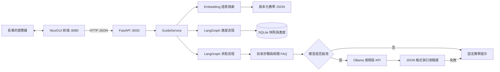
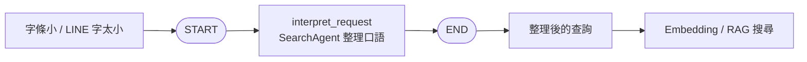
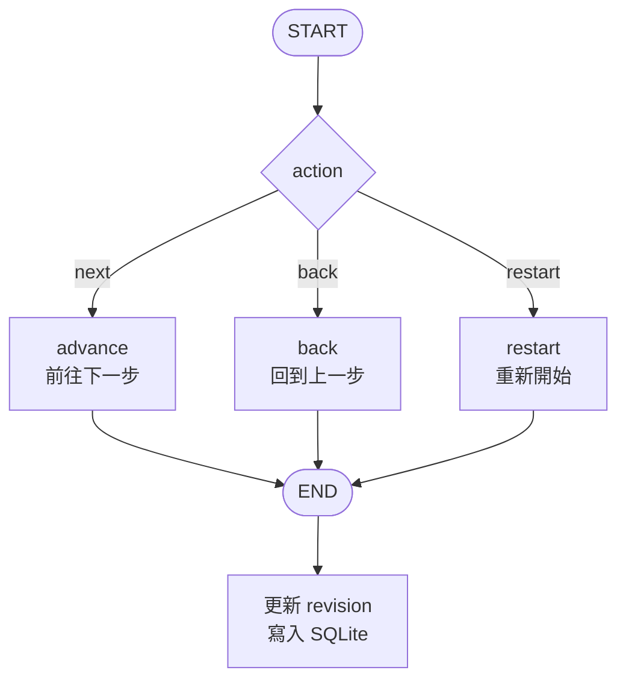
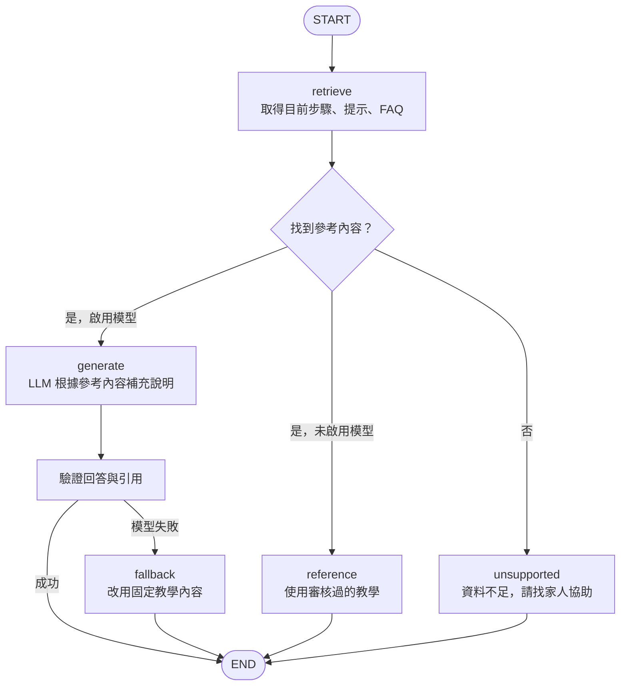
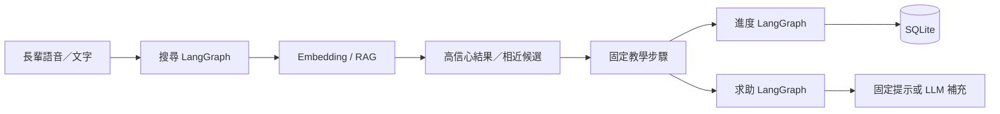
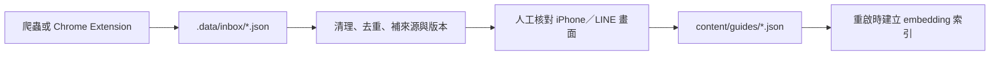

# 架構與取捨

## 目錄分工與依賴方向

專案根目錄 `main.py` 是開發啟動器，執行 `python main.py` 同時啟動前後端。
`backend/main.py` 是 Uvicorn 的 ASGI 入口，只匯入工廠並建立 app。
`backend/application.py` 是依賴組裝處：讀取設定、建立服務、註冊路由與生命週期。

| 要修改的內容 | 放置位置 |
| --- | --- |
| 新增 API 端點 | `backend/api/routes/`，再由 `api/router.py` 註冊 |
| HTTP 依賴注入／錯誤回應 | `backend/api/dependencies.py` / `errors.py` |
| 協調搜尋、進度、儲存等使用案例 | `backend/services.py` |
| LangGraph 狀態與流程節點 | `backend/agents/` |
| 模型介面、供應商請求、建立方式 | `backend/llm/base.py` / `client.py` / `factory.py` / `search_agent.py` |
| 系統提示詞 | `backend/llm/prompts.py` |
| 環境變數與預設路徑 | `backend/config.py` |
| 資料驗證格式 | `backend/models.py` |
| 內容載入與檢索 | `backend/rag/` |
| SQLite 存取 | `backend/repositories.py` |

依賴由外向內：API 呼叫 services，services 協調 agents、rag 和 repositories。
agents 只透過 `llm/base.py` 的介面使用模型，具體 client 由 application / factory 組裝。
內層模組不要反向匯入 API 或 application；前端繼續只透過 HTTP 溝通。

目前 `models.py` 集中管理小規模的資料格式，LLM client 共用現有兩種 HTTP 格式。
當資料模型或供應商變多時，再在各自目錄內依領域拆分；不需要回頭修改根目錄結構。

## 核心資料流

語音頁的錄音在瀏覽器由 `MediaRecorder` 產生，經 NiceGUI 的同來源 proxy 送到
`POST /api/transcribe`；FastAPI 在 worker thread 呼叫本地 SenseVoiceSmall，再用 OpenCC
轉為繁體文字回傳前端。Whisper base 保留為可設定的備援 provider。
錄音檔不落地保存，瀏覽器只保留目前頁面的文字狀態。

## LangGraph 流程圖

目前有三張 LangGraph 圖，全部由 `backend/services.py` 組裝。圖中的 `START` 和 `END`
是 LangGraph 的流程起點與終點。

### 搜尋圖：語音／文字整理成查詢

程式位置：`backend/agents/search.py`。Agent 只整理長輩的說法，不產生教學步驟；
沒有啟用模型時，這一步會直接使用原始文字。

### 教學進度圖：下一步、上一步、重新練習

程式位置：`backend/agents/progress.py`。這張圖不呼叫 LLM，確保教學順序固定，
並由 `revision` 防止重複點擊或多個分頁互相覆蓋進度。

### 求助圖：使用者在教學中卡住

程式位置：`backend/agents/assistance.py`。模型只能根據目前步驟和 FAQ 補充說明，
不能改寫或跳過固定教學步驟；模型失敗時會回到審核過的提示。

### 使用者操作的完整路徑

維護時可以先判斷問題落在哪一段：畫面問題看 `frontend/app.py`，查詢問題看
`backend/agents/search.py` 和 `backend/rag/`，步驟前進問題看 `backend/agents/progress.py`，
教學中求助問題看 `backend/agents/assistance.py`。

## 為什麼把步驟存成結構化內容

長輩要知道「現在按哪裡」，需要穩定的順序與按鈕名稱。每份教學是完整的操作 recipe，
檢索以 recipe 為單位，避免把不同手機或不同 App 的操作碎片拼在一起。

`Guide` 包含裝置、App、修訂版、來源、適用性說明、步驟、提示、確認點與 FAQ。
`Step.illustration` 是版面提示。前端自行畫示意圖，後端不包含 NiceGUI 元件。

## 資料存放與 ETL 分層

目前刻意不把向量資料庫當成原始資料庫。資料分成四層：

| 層 | 位置 | 用途 | 是否提交 Git |
| --- | --- | --- | --- |
| 原始擷取 | `.data/official-sources/` 或未來的 `.data/inbox/` | 爬蟲／Chrome Extension 擷取的來源快照 | 否 |
| 審核內容 | `content/guides/*.json` | 維護者整理給長輩看的正式教學，唯一真相來源 | 是 |
| 搜尋索引 | 啟動時由 `bge-m3` 建立的記憶體向量 | 依語意找出教學；可刪除、可重建 | 否 |
| 使用進度 | `.data/sessions.sqlite3` | 使用者目前做到哪一步 | 否 |

所以目前是「JSON 存內容、SQLite 存進度、向量只做索引」，尚未使用 Qdrant、Chroma 或
pgvector。這樣做的好處是教學可以直接審查、做版本控制和多人協作；換 embedding 模型或
未來導入向量服務時，只要從 JSON 重建索引，不會遺失內容。

未來若加入 Chrome Extension，建議讓 Extension 只輸出擷取包到 `.data/inbox/`，格式至少
包含 `source_url`、`provider`、`captured_at`、`title`、`headings`、`paragraphs`、`steps`
和 `content_hash`。ETL 流程固定為：

不要讓擷取程式直接寫入向量資料庫或直接覆蓋正式教學；向量索引應該是可重建的產物，
而正式 JSON 才是長期維護與開源協作的介面。

### 是否拆成另一個專案

目前不急著拆成第二個 Git repository。MVP 先在同一個 repository 內用 `etl/` 隔離
資料流程，讓 `collect_official.py`、未來的 `import_capture.py` 和 `build_index.py` 都是
獨立入口；前後端不直接依賴擷取程式。這樣可以維持簡單目錄，也能讓 ETL 先獨立測試。

等到 ETL 有自己的部署週期、排程、敏感憑證、依賴套件或維護者，再拆成例如
`elder-guide-data` 的 repository。拆分後由資料專案產生版本化的教學 JSON 套件，主服務只
固定引用某個版本，不直接連線到資料專案或向量資料庫。Chrome Extension 也可在那時獨立
成自己的小專案，輸出同一份擷取包格式。

啟動時驗證全部內容；重複 ID、遺漏步驟、無來源或錯誤格式會直接停止啟動。
新增／修改 JSON 後重啟後端即可重建索引。已有 session 保留啟動當下的內容快照，
避免有人做在第 3 步時，內容編輯讓第 3 步忽然變成其他動作。

## LangGraph 的工作

進度圖：`START → next / back / restart → END`。
每次 next 只完成一個動作；最後一步才標為 completed。

求助圖：`retrieve → reference / generate / unsupported → END`。
問「這一步找不到」時，取出目前步驟的操作、提示與確認點。
其他問題以字元向量檢索同一份教學的 FAQ，沒有足夠匹配就返回資料不足。
模型接入透過 `Explainer` protocol；HTTP adapter 支援 Ollama 和相容端點。
`SearchAgent` 只將自然語言／語音轉成 RAG 查詢，禁止產生操作步驟。

進度持久化使用應用層 SQLite，**沒有使用 LangGraph checkpointer / interrupt**。
每次 HTTP 要求先載入 session，再執行一次有邊界的圖，最後寫回；
目前不需要長時間自主執行 agent。未來若導入多輪裝置辨識，再考慮圖的持久 checkpoint。

## 檢索方式

正式服務使用 Ollama 的整句 embedding（預設 `bge-m3`）與 cosine similarity。
教學標題、摘要和常用問法會在啟動時建立向量；每次查詢只做一次 query embedding，
再套用 iPhone／LINE 的篩選與相似度門檻。這能處理「LINE 文字放大」、「把聊天字調大」
等不同說法，不需要為每一種句型手動切詞。

搜尋回應分成兩層：`hits` 是高信心命中，可直接開始教學；`suggestions` 是較接近但需要
使用者確認的候選。例如「字條小」會列出 LINE 和 iPhone 兩份字體教學，避免錯字直接變成空白頁。

未設定 Ollama 時，`llm_provider=none` 會使用內建的中文 2/3 字元 n-gram TF-IDF，
讓離線測試和沒有模型的開發環境仍可運作。這個 fallback 只在沒有 embedder 時啟用，
正式環境若 embedding 不可用會交給服務層走網路參考／無結果流程，不會靜默混用兩種分數。
未來要換 Qdrant、pgvector 或其他向量服務，只需替換 `rag/` 的 adapter，API 與教學格式不變。

新增或修改 `content/guides/*.json` 後必須重啟服務，因為索引和向量是在啟動時建立。

官方資料收集器 `etl/collect_official.py` 只負責取得核准來源的結構化筆記；
它不會自動覆蓋教學 JSON。這個界線讓官方頁面更新時，仍由維護者確認版本與操作畫面，
再決定是否更新長輩版本的教學。

## 進度、併發與隱私

- 每次開始產生隨機 UUID，內容快照與步驟存於 SQLite。
- action 必須帶 `expected_revision`；資料庫以 compare-and-swap 原子更新。
  重複點擊或多分頁的舊要求返回 409，前端重新載入最新進度。
- 前端每頁 state 放在 page closure，cookie 對應的 `app.storage.user` 僅記住 session ID、頁面與字級。
- 目前未紀錄問題歷史，也沒有音訊／螢幕／上傳資料。瀏覽器朗讀只接收這一步的教學文字。
- UUID 是本機 MVP 的進度持有憑證，不等於登入授權。API 沒有 session 列表端點。
  公開部署前需加入登入／授權、保留期限、刪除方式、速率限制及適當的 HTTPS 與服務管理。

## API

| 端點 | 用途 |
| --- | --- |
| `GET /health` | 程式狀態、教學數量、設定的模型 provider；不表示模型端點可用 |
| `GET /api/guides?platform=ios` | 列出適用教學 |
| `POST /api/search` | 用 query 查找教學 |
| `POST /api/sessions` | 用 guide_id 建立新進度 |
| `GET /api/sessions/{id}` | 恢復進度與目前步驟 |
| `POST /api/sessions/{id}/actions` | next / back / restart，必須帶 expected_revision |
| `POST /api/sessions/{id}/help` | 目前步驟提示／FAQ，永不改變進度 |

實際 schema 請看 `/docs`，由 Pydantic models 自動產生。

## 開發依據

- [FastAPI 測試](https://fastapi.tiangolo.com/tutorial/testing/)
- [LangGraph Quickstart](https://docs.langchain.com/oss/python/langgraph/quickstart)
- [NiceGUI 官方參考](https://github.com/zauberzeug/nicegui/blob/main/nicegui/llms.md)
- [Ollama Chat API](https://docs.ollama.com/api/chat)
- [Ollama 結構化輸出](https://docs.ollama.com/capabilities/structured-outputs)
- [OpenAI Chat Completions API](https://developers.openai.com/api/reference/python/resources/chat/subresources/completions/methods/create)
